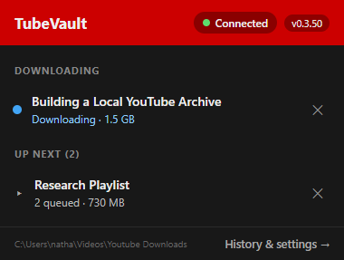
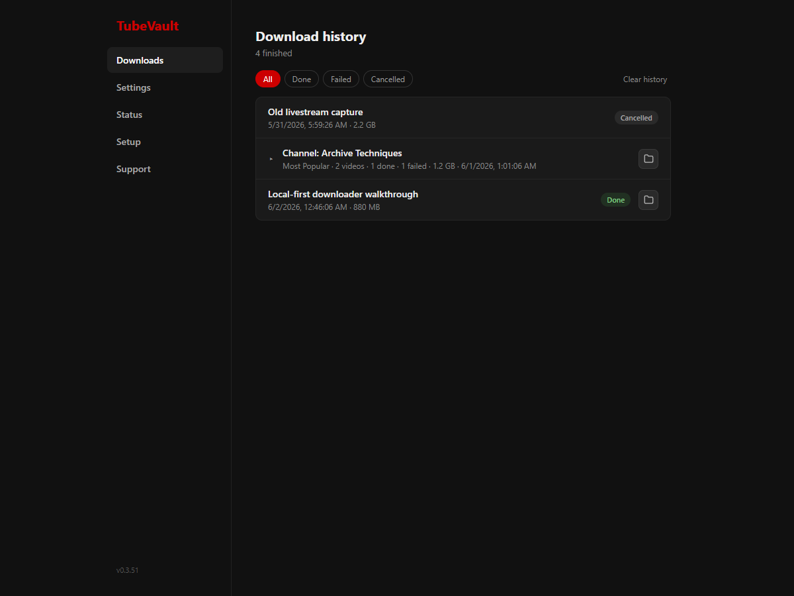
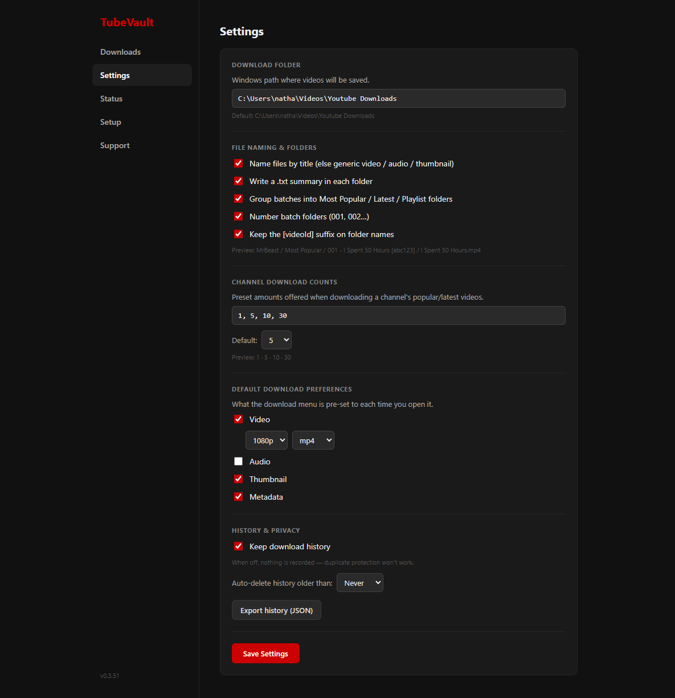
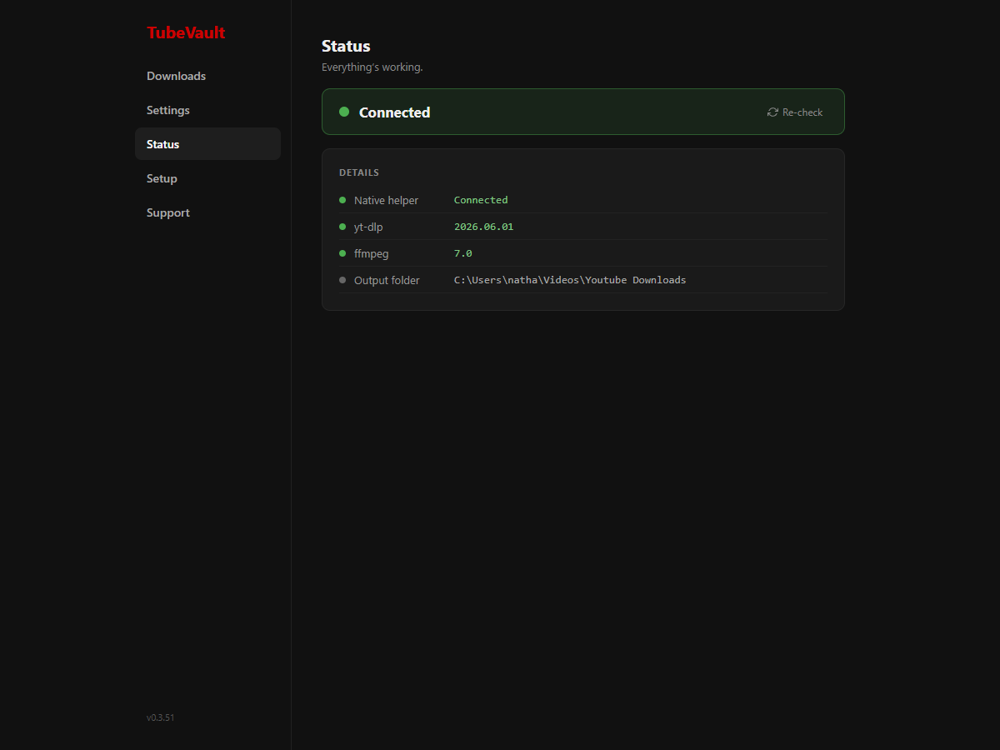
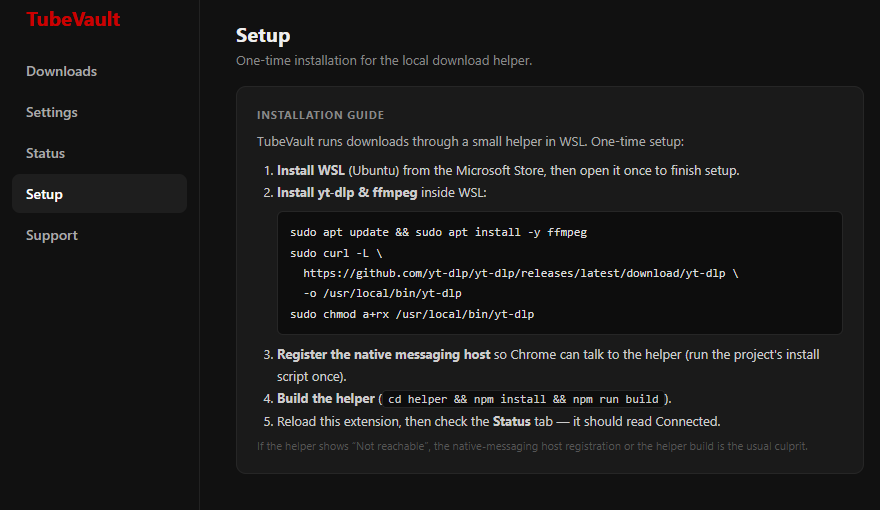

# TubeVault

TubeVault is a local-first Chrome extension for archiving YouTube videos, playlists, channels, Shorts, live videos, thumbnails, subtitles, audio, and metadata to your own machine.
The Chrome extension provides the YouTube controls, serial download queue, popup, history, settings, and diagnostics.
A local Node.js native messaging helper runs `yt-dlp` and `ffmpeg` without a TubeVault server.

## Features

- Adds download controls to YouTube watch, live, Shorts, playlist, mix, and channel pages.
- Selects video quality and format, audio format, subtitles, thumbnails, and metadata per request.
- Expands playlist and channel requests into individually selectable per-video jobs.
- Probes batch rows progressively for title, expected size, duration, and view count.
- Keeps downloads and queue-time probes serial, while planning and visible-row probes use bounded concurrency.
- Supports SponsorBlock chapter marking or explicit segment removal.
- Supports concurrent media fragments for faster individual downloads.
- Shows active work, queued batches, recent results, and acknowledged cancellation controls in the popup.
- Stores optional local download history with retention controls, export, and a 100-item cap.
- On restart, durably cancels interrupted native work before marking it interrupted or cancelled and resuming the queue.
- Uses a cross-platform helper on Windows with WSL, macOS, and Linux.
- Resolves a platform-appropriate default output folder without hardcoded usernames.

Browser-cookie access and parallel downloads of multiple videos are not implemented.
They remain deliberate backlog items because both require additional privacy, locking, and rate-limit safeguards.

## Project Layout

```text
extension/          Chrome MV3 extension, React UI, service worker, and content script
helper/             Node.js native messaging helper that calls yt-dlp and ffmpeg
native-messaging/   Native messaging host manifest template
scripts/            Windows sync, registration, launcher, and screenshot scripts
tests/e2e/          Playwright Chromium smoke tests
SETUP.md            Installation and troubleshooting guide
```

## Install and Build

Install all three dependency sets from the repository root:

```bash
npm run install:all   # npm ci at the root, in extension/ and in helper/
```

The root `.npmrc` sets `allow-git=root`, because npm 12 refuses git dependencies by default and release-kit is one.

Build both packages:

```bash
npm run build
```

The default build is portable and side-effect free.
It writes bundles only to `extension/dist` and `helper/dist`.
It does not change versions, copy to another checkout, stage files, commit, or push.

See [SETUP.md](SETUP.md) for native messaging registration and platform-specific prerequisites.

## Development Commands

```bash
npm run build       # Build extension and helper
npm run typecheck   # Type-check both packages
npm run lint        # Lint source, tests, and build scripts
npm test            # Run script, extension, and helper unit tests
npm run test:e2e    # Build and run unpacked-extension Chromium smoke tests
npm run check       # Lint, type-check, unit test, and build
```

Install the bundled Playwright browser before the first local E2E run:

```bash
npx playwright install chromium
```

On Linux CI or a new Linux workstation, install Chromium and its system dependencies with:

```bash
npx playwright install --with-deps chromium
```

## Continuous Integration

GitHub Actions runs the full `npm run check` pipeline and Chromium smoke suite for pushes and pull requests.
Trusted pushes use the repository-scoped `n8desktop-tube-vault` self-hosted WSL runner with the `tube-vault` label.
Because this repository is public, pull requests continue to use a GitHub-hosted Ubuntu runner so untrusted changes cannot execute on the development machine.
The local runner is installed outside the repository at `/home/natkins/actions-runners/tube-vault` and managed by the `github-actions-tube-vault.service` user service.
If the development machine is offline, push jobs remain queued until the local runner reconnects.

Watch all four extension entry points without release side effects:

```bash
npm run watch --prefix extension
```

## Explicit Windows Sync

Chrome on Windows cannot load an unpacked extension directly from the WSL Linux filesystem reliably.
Build and copy the runtime artifacts to an existing Windows checkout explicitly:

```bash
npm run sync:windows -- --target /mnt/c/Users/<you>/Projects/tube-vault
```

You can set `TUBE_VAULT_WINDOWS_REPO` instead of passing `--target`.
The CLI argument takes precedence when both are present.
The destination must be the absolute root of an existing Git repository with TubeVault extension and helper package identities.
The command copies only the extension manifest, HTML, icons, bundles, helper bundles, and helper package metadata.
Existing allowlisted destinations must be regular files; the sync rejects symbolic links and other file types without moving or deleting them.
The copy is serialized and transactional: a failed publication restores replaced allowlisted files and removes newly installed allowlisted files when they are still owned by that transaction.
If another process changes an artifact concurrently, the sync preserves that change and retains its transaction backups rather than overwriting data it no longer owns.
The next sync recovers an interrupted transaction before publishing new artifacts when its ownership records still match, and otherwise stops for manual inspection.
Files outside the allowlist are never deleted.

Reload the unpacked extension at `chrome://extensions` after syncing.

## Releases

TubeVault releases with [release-kit](https://github.com/n8watkins/release-kit), like the owner's other repositories.
[RELEASING.md](RELEASING.md) is the full standard; this section covers what is specific to TubeVault.

- Every commit is a Conventional Commit, checked by the `commit-msg` hook and the Commit messages workflow.
  `feat`, `fix`, `perf` and `security` subjects become the release notes, so write them for users; add `Release-note: skip` to the body of one no user would notice.
- Pull requests are squash-merged with the PR title as the subject, so the commit ends in `(#N)`; release-kit links that to the pull request in the notes.
  Nothing has to happen after a merge: there is no changelog to regenerate and no release PR.
- Releases are cut from `review/tube-vault-v0.3.81`, the branch Chrome runs, or from `master` (`.release.json` `branches`).
  There is no release train, because it only runs on `main` or `master`.
- `npm run release` bumps every version file together: `package.json` and its lock, `extension/package.json` and its lock, `extension/manifest.json`, and `helper/package.json` and its lock (`.release.json` `versionFiles`).
  It prepends the release's section to `CHANGELOG.md`, commits `chore(release): vX.Y.Z` and tags it.

Cut a release from an up-to-date checkout of the release branch:

```bash
npm run release -- --dry-run          # preview the version and the notes
npm run release -- patch --push       # check, bump, changelog, commit, tag, push
npm run sync:windows -- --target /mnt/c/Users/natha/Projects/Tools/tube-vault
```

With `--push`, release-kit first runs `npm run release:check` (it installs the extension and helper dependencies, then lints, type-checks, tests and builds), and pushes the branch and the tag together.
The tag runs the Release workflow, which checks the tag against every version file, runs the same checks and publishes the GitHub Release with the notes.
The sync refuses to publish a tree whose version files disagree, then builds and copies the bundles, `extension/manifest.json` and the helper package files, so Chrome and the helper report the released version.
Reload the unpacked extension at `chrome://extensions` afterwards.

## Options Page

The options page has four tabs:

- **Downloads** contains finished history, grouped batches, filters, folder actions, JSON export, and history clearing.
- **Settings** controls the output root, naming, component defaults, quality and formats, notifications, history retention, SponsorBlock, faster fragments, thumbnails, and channel counts.
- **Status** checks the native helper, `yt-dlp`, `ffmpeg`, and resolved output path.
- **Setup** provides the one-time local helper checklist.

## Screenshots

### Popup

The popup focuses on current work, recent results, connection status, quick cancellation, and shortcuts to history and settings.



### Downloads

The Downloads tab provides local history and batch grouping without crowding the popup.



### Settings

The Settings tab controls download behavior, formats, naming, history, and advanced options.



### Status

The Status tab is the first place to inspect helper or local tool failures.



### Setup

The Setup tab keeps the core installation checklist available inside the extension.



## Privacy

TubeVault has no application server.
The extension uses Chrome storage and sends commands to the local native helper.
The helper runs local `yt-dlp` and `ffmpeg` processes and writes to the configured local folder.
YouTube and `yt-dlp` still operate under their own network behavior and terms.

## Changelog

See [CHANGELOG.md](CHANGELOG.md) and the repository's GitHub Releases.
From v0.3.108 on, `npm run release` writes each section from the Conventional Commits since the previous tag; the sections below it were written by the generator TubeVault used before release-kit.
Never edit the file by hand.
